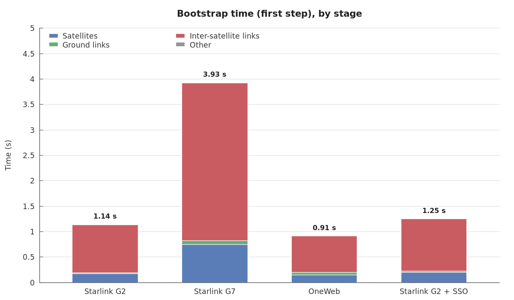
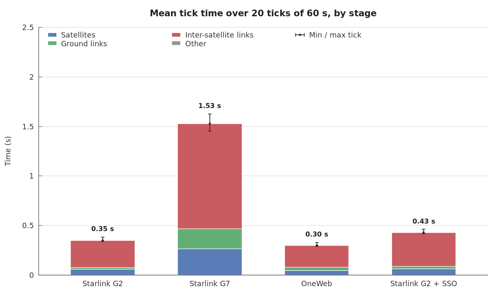

# Performance Using Optical Links Advanced Model

Bootstrap time (`BaseConfigurationManager.load_simulation`) and tick time of the optical inter-satellite link (OISL) advanced model on reference constellations, broken down by stage.

_This page is generated by [`tests/performance_scripts/benchmark_constellations.py`](../../tests/performance_scripts/benchmark_constellations.py). Do not edit it by hand: rerun the script. Each run adds a line to the history below. Working files (gnuplot scripts, data, raw results) go to `dist/performance/`._

```bash
.venv/bin/python tests/performance_scripts/benchmark_constellations.py
```

## Scenarios

Parameters from the LEO-NET 2026 paper (constellation table). The plane layouts, not given in the paper, follow the public filings matching its satellite counts.

| Scenario | Shells | ISL layout | ISL strategy |
|---|---|---|---|
| Starlink G2 | Walker Delta 36 × 20 = 720 sat., 570 km, 70° | 4 ISL, full mesh | intra-shell static |
| Starlink G7 | Walker Delta 28 × 120 = 3,360 sat., 530 km, 53° | 3 ISL, checkerboard | intra-shell static |
| OneWeb | Walker Star 12 × 49 = 588 sat., 1,200 km, 87.9° | 4 ISL, full mesh (Walker Star) | intra-shell static |
| Starlink G2 + SSO | Starlink G2 + dawn-dusk SSO 81 sat., 650 km | G2: 4 + 1 ISL, SSO: 2 + 1 ISL (+1 = inter-shell, 10,000 km range) | inter-shell SSO priority |

Every scenario has the same 100 ground stations (`everything-visible`, 20° minimum elevation). Each scenario runs 20 ticks of 60 s, starting 2026-01-01 00:00:00, in its own Python process.

## Results





| Scenario | Satellites | ISLs | Ground links | Bootstrap | Mean tick | Min / max tick | Peak memory |
|---|---|---|---|---|---|---|---|
| Starlink G2 | 720 | 1,440 | 482 | 1.14 s | 0.35 s | 0.34 s / 0.38 s | 201 MB |
| Starlink G7 | 3,360 | 5,040 | 2,753 | 3.93 s | 1.53 s | 1.45 s / 1.63 s | 321 MB |
| OneWeb | 588 | 1,127 | 1,089 | 0.91 s | 0.30 s | 0.29 s / 0.33 s | 191 MB |
| Starlink G2 + SSO | 801 | 1,602 | 557 | 1.25 s | 0.43 s | 0.42 s / 0.46 s | 205 MB |

### Where the time goes

| Scenario | Phase | Satellites | Ground links | Inter-satellite links | Other |
|---|---|---|---|---|---|
| Starlink G2 | bootstrap | 0.18 s (16%) | 0.02 s (2%) | 0.94 s (83%) | 0.00 s (0%) |
| Starlink G2 | mean tick | 0.06 s (16%) | 0.02 s (6%) | 0.27 s (78%) | 0.00 s (0%) |
| Starlink G7 | bootstrap | 0.75 s (19%) | 0.08 s (2%) | 3.10 s (79%) | 0.00 s (0%) |
| Starlink G7 | mean tick | 0.26 s (17%) | 0.20 s (13%) | 1.06 s (69%) | 0.00 s (0%) |
| OneWeb | bootstrap | 0.15 s (16%) | 0.06 s (6%) | 0.71 s (78%) | 0.00 s (0%) |
| OneWeb | mean tick | 0.05 s (15%) | 0.03 s (11%) | 0.22 s (74%) | 0.00 s (0%) |
| Starlink G2 + SSO | bootstrap | 0.20 s (16%) | 0.02 s (2%) | 1.03 s (82%) | 0.00 s (0%) |
| Starlink G2 + SSO | mean tick | 0.06 s (15%) | 0.02 s (6%) | 0.34 s (79%) | 0.00 s (0%) |

Stages:
- **Satellites**: bootstrap = constellation generation (TLEs, satellite objects); tick = position update of satellites and ground objects.
- **Ground links**: bootstrap = ground objects loading and first ground links; tick = ground station and user terminal link updates.
- **Inter-satellite links**: bootstrap = addressing plans, static terminal selection and first ISL computation; tick = ISL update (constraint refresh, inter-shell assignment).
- **Other**: everything else (simulation objects, time manager, event bookkeeping).

## History

Bootstrap / mean tick, most recent run first. Compare runs made on the same machine.

| Date | Commit | Ticks | Starlink G2 | Starlink G7 | OneWeb | Starlink G2 + SSO |
|---|---|---|---|---|---|---|
| 2026-10-31 16:33 | `f71ef48 (with uncommitted changes)` | 20 × 60 s | 1.14 s / 0.35 s | 3.93 s / 1.53 s | 0.91 s / 0.30 s | 1.25 s / 0.43 s |

## Machine (latest run)

- CPU: 12th Gen Intel(R) Core(TM) i7-12800H (20 logical cores, the simulation uses one)
- Python 3.10.12 on Linux 6.8.0-138-generic
- Commit: `f71ef48 (with uncommitted changes)`

<!-- benchmark-history (generated, one JSON object per run)
{"date": "2026-10-31 16:33", "commit": "f71ef48 (with uncommitted changes)", "ticks": 20, "tick_seconds": 60.0, "cpu": "12th Gen Intel(R) Core(TM) i7-12800H", "results": {"Starlink G2": {"bootstrap": 1.1365, "tick": 0.3495}, "Starlink G7": {"bootstrap": 3.9256, "tick": 1.5299}, "OneWeb": {"bootstrap": 0.9145, "tick": 0.297}, "Starlink G2 + SSO": {"bootstrap": 1.2493, "tick": 0.4281}}}
end-of-benchmark-history -->
