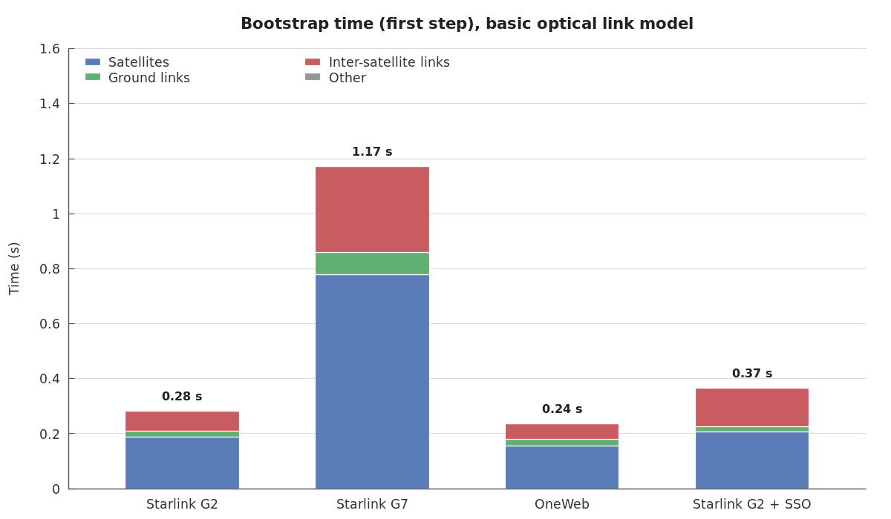
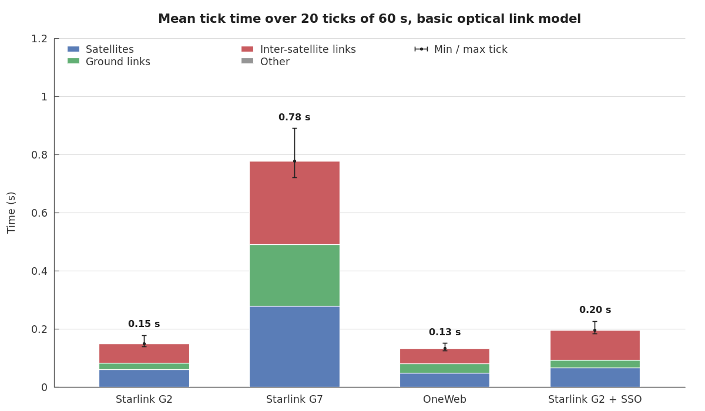
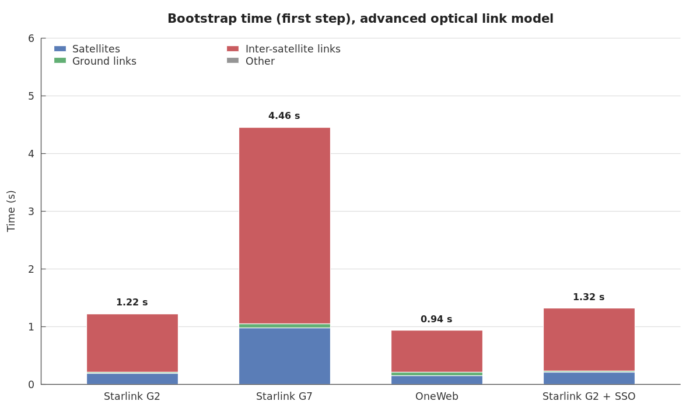
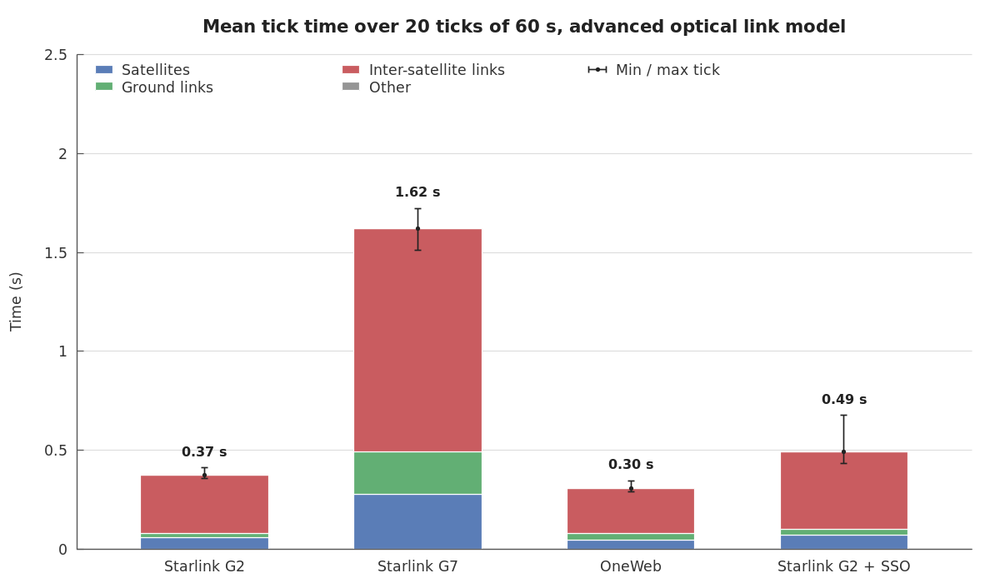

# SatComTopology Performance

Bootstrap time (`BaseConfigurationManager.load_simulation`) and tick time on reference constellations, broken down by stage, for both optical inter-satellite link models:

- [Performance Using Optical Links Basic Model](#performance-using-optical-links-basic-model)
- [Performance Using Optical Links Advanced Model](#performance-using-optical-links-advanced-model)

_This page is generated by [`tests/performance_scripts/benchmark_constellations.py`](../../tests/performance_scripts/benchmark_constellations.py). Do not edit it by hand: rerun the script. Each run adds a line to the history below. Working files (gnuplot scripts, data, raw results) go to `dist/performance/`._

```bash
.venv/bin/python tests/performance_scripts/benchmark_constellations.py
```

## Scenarios

Parameters from the LEO-NET 2026 paper (constellation table). The plane layouts, not given in the paper, follow the public filings matching its satellite counts.

| Scenario | Shells | ISL layout | ISL strategy |
|---|---|---|---|
| Starlink G2 | Walker Delta 36 × 20 = 720 sat., 570 km, 70° | 4 ISL, full mesh | intra-shell static |
| Starlink G7 | Walker Delta 28 × 120 = 3,360 sat., 530 km, 53° | 3 ISL, checkerboard | intra-shell static |
| OneWeb | Walker Star 12 × 49 = 588 sat., 1,200 km, 87.9° | 4 ISL, full mesh (Walker Star) | intra-shell static |
| Starlink G2 + SSO | Starlink G2 + dawn-dusk SSO 81 sat., 650 km | G2: 4 + 1 ISL, SSO: 2 + 1 ISL (+1 = inter-shell, 10,000 km range) | inter-shell SSO priority |

Every scenario has the same 100 ground stations (`everything-visible`, 20° minimum elevation). Each scenario runs 20 ticks of 60 s, starting 2026-01-01 00:00:00, in its own Python process.

Stages:
- **Satellites**: bootstrap = constellation generation (TLEs, satellite objects); tick = position update of satellites and ground objects.
- **Ground links**: bootstrap = ground objects loading and first ground links; tick = ground station and user terminal link updates.
- **Inter-satellite links**: bootstrap = addressing plans, terminal selection and first ISL computation; tick = ISL update.
- **Other**: everything else (simulation objects, time manager, event bookkeeping).

## Performance Using Optical Links Basic Model

`optical_inter_satellite_link_model: basic`, the default, used by most simulations. Links follow the addressing plans: terminals are only connection slots, no optical metric is computed and links are never dropped for geometry. Only the straight-line distance is computed. In Starlink G2 + SSO, the inter-shell links are still computed by the inter-shell strategy, which needs the optical metrics: only the intra-shell links are basic.





| Scenario | Satellites | ISLs | Ground links | Bootstrap | Mean tick | Min / max tick | Peak memory |
|---|---|---|---|---|---|---|---|
| Starlink G2 | 720 | 1,440 | 482 | 0.28 s | 0.15 s | 0.14 s / 0.18 s | 170 MB |
| Starlink G7 | 3,360 | 5,040 | 2,753 | 1.17 s | 0.78 s | 0.72 s / 0.89 s | 221 MB |
| OneWeb | 588 | 1,127 | 1,089 | 0.24 s | 0.13 s | 0.13 s / 0.15 s | 168 MB |
| Starlink G2 + SSO | 801 | 1,602 | 557 | 0.37 s | 0.20 s | 0.18 s / 0.23 s | 186 MB |

Where the time goes:

| Scenario | Phase | Satellites | Ground links | Inter-satellite links | Other |
|---|---|---|---|---|---|
| Starlink G2 | bootstrap | 0.19 s (66%) | 0.02 s (8%) | 0.07 s (26%) | 0.00 s (0%) |
| Starlink G2 | mean tick | 0.06 s (41%) | 0.02 s (15%) | 0.07 s (44%) | 0.00 s (0%) |
| Starlink G7 | bootstrap | 0.78 s (66%) | 0.08 s (7%) | 0.31 s (27%) | 0.00 s (0%) |
| Starlink G7 | mean tick | 0.28 s (36%) | 0.21 s (27%) | 0.29 s (37%) | 0.00 s (0%) |
| OneWeb | bootstrap | 0.16 s (66%) | 0.02 s (10%) | 0.06 s (24%) | 0.00 s (0%) |
| OneWeb | mean tick | 0.05 s (36%) | 0.03 s (25%) | 0.05 s (39%) | 0.00 s (0%) |
| Starlink G2 + SSO | bootstrap | 0.21 s (56%) | 0.02 s (6%) | 0.14 s (38%) | 0.00 s (0%) |
| Starlink G2 + SSO | mean tick | 0.07 s (34%) | 0.03 s (13%) | 0.10 s (53%) | 0.00 s (0%) |

## Performance Using Optical Links Advanced Model

`optical_inter_satellite_link_model: advanced`, optional: enable it only when the simulation needs the optical terminal constraints. Every optical inter-satellite link is checked against its terminals configuration (elevation, azimuth, range, angular velocity, line of sight) and carries its optical constraints. Links can be dropped when the geometry breaks them.





| Scenario | Satellites | ISLs | Ground links | Bootstrap | Mean tick | Min / max tick | Peak memory |
|---|---|---|---|---|---|---|---|
| Starlink G2 | 720 | 1,440 | 482 | 1.22 s | 0.37 s | 0.36 s / 0.41 s | 202 MB |
| Starlink G7 | 3,360 | 5,040 | 2,753 | 4.46 s | 1.62 s | 1.51 s / 1.72 s | 324 MB |
| OneWeb | 588 | 1,127 | 1,089 | 0.94 s | 0.30 s | 0.29 s / 0.34 s | 192 MB |
| Starlink G2 + SSO | 801 | 1,602 | 557 | 1.32 s | 0.49 s | 0.43 s / 0.68 s | 206 MB |

Where the time goes:

| Scenario | Phase | Satellites | Ground links | Inter-satellite links | Other |
|---|---|---|---|---|---|
| Starlink G2 | bootstrap | 0.19 s (16%) | 0.02 s (2%) | 1.01 s (82%) | 0.00 s (0%) |
| Starlink G2 | mean tick | 0.06 s (16%) | 0.02 s (6%) | 0.29 s (78%) | 0.00 s (0%) |
| Starlink G7 | bootstrap | 0.97 s (22%) | 0.08 s (2%) | 3.40 s (76%) | 0.00 s (0%) |
| Starlink G7 | mean tick | 0.28 s (17%) | 0.21 s (13%) | 1.13 s (70%) | 0.00 s (0%) |
| OneWeb | bootstrap | 0.15 s (16%) | 0.05 s (6%) | 0.73 s (78%) | 0.00 s (0%) |
| OneWeb | mean tick | 0.05 s (15%) | 0.03 s (11%) | 0.23 s (74%) | 0.00 s (0%) |
| Starlink G2 + SSO | bootstrap | 0.20 s (16%) | 0.02 s (2%) | 1.09 s (83%) | 0.00 s (0%) |
| Starlink G2 + SSO | mean tick | 0.07 s (15%) | 0.03 s (6%) | 0.39 s (79%) | 0.00 s (0%) |

## History

Bootstrap / mean tick, most recent run first. Compare runs made on the same machine.

### Basic model

| Date | Commit | Ticks | Starlink G2 | Starlink G7 | OneWeb | Starlink G2 + SSO |
|---|---|---|---|---|---|---|
| 2026-10-31 17:14 | `8706502 (with uncommitted changes)` | 20 × 60 s | 0.28 s / 0.15 s | 1.17 s / 0.78 s | 0.24 s / 0.13 s | 0.37 s / 0.20 s |

### Advanced model

| Date | Commit | Ticks | Starlink G2 | Starlink G7 | OneWeb | Starlink G2 + SSO |
|---|---|---|---|---|---|---|
| 2026-10-31 17:14 | `8706502 (with uncommitted changes)` | 20 × 60 s | 1.22 s / 0.37 s | 4.46 s / 1.62 s | 0.94 s / 0.30 s | 1.32 s / 0.49 s |
| 2026-10-31 16:33 | `f71ef48 (with uncommitted changes)` | 20 × 60 s | 1.14 s / 0.35 s | 3.93 s / 1.53 s | 0.91 s / 0.30 s | 1.25 s / 0.43 s |

## Machine (latest run)

- CPU: 12th Gen Intel(R) Core(TM) i7-12800H (20 logical cores, the simulation uses one)
- Python 3.10.12 on Linux 6.8.0-138-generic
- Commit: `a420e22 (with uncommitted changes)`

<!-- benchmark-history (generated, one JSON object per run)
{"date": "2026-10-31 16:33", "commit": "f71ef48 (with uncommitted changes)", "ticks": 20, "tick_seconds": 60.0, "cpu": "12th Gen Intel(R) Core(TM) i7-12800H", "results_by_model": {"advanced": {"Starlink G2": {"bootstrap": 1.1365, "tick": 0.3495}, "Starlink G7": {"bootstrap": 3.9256, "tick": 1.5299}, "OneWeb": {"bootstrap": 0.9145, "tick": 0.297}, "Starlink G2 + SSO": {"bootstrap": 1.2493, "tick": 0.4281}}}}
{"date": "2026-10-31 17:14", "commit": "8706502 (with uncommitted changes)", "ticks": 20, "tick_seconds": 60.0, "cpu": "12th Gen Intel(R) Core(TM) i7-12800H", "results_by_model": {"advanced": {"Starlink G2": {"bootstrap": 1.2206, "tick": 0.3723}, "Starlink G7": {"bootstrap": 4.4564, "tick": 1.6215}, "OneWeb": {"bootstrap": 0.9357, "tick": 0.3048}, "Starlink G2 + SSO": {"bootstrap": 1.3173, "tick": 0.4902}}, "basic": {"Starlink G2": {"bootstrap": 0.2839, "tick": 0.1489}, "Starlink G7": {"bootstrap": 1.1723, "tick": 0.7784}, "OneWeb": {"bootstrap": 0.2375, "tick": 0.132}, "Starlink G2 + SSO": {"bootstrap": 0.3661, "tick": 0.1953}}}}
end-of-benchmark-history -->
