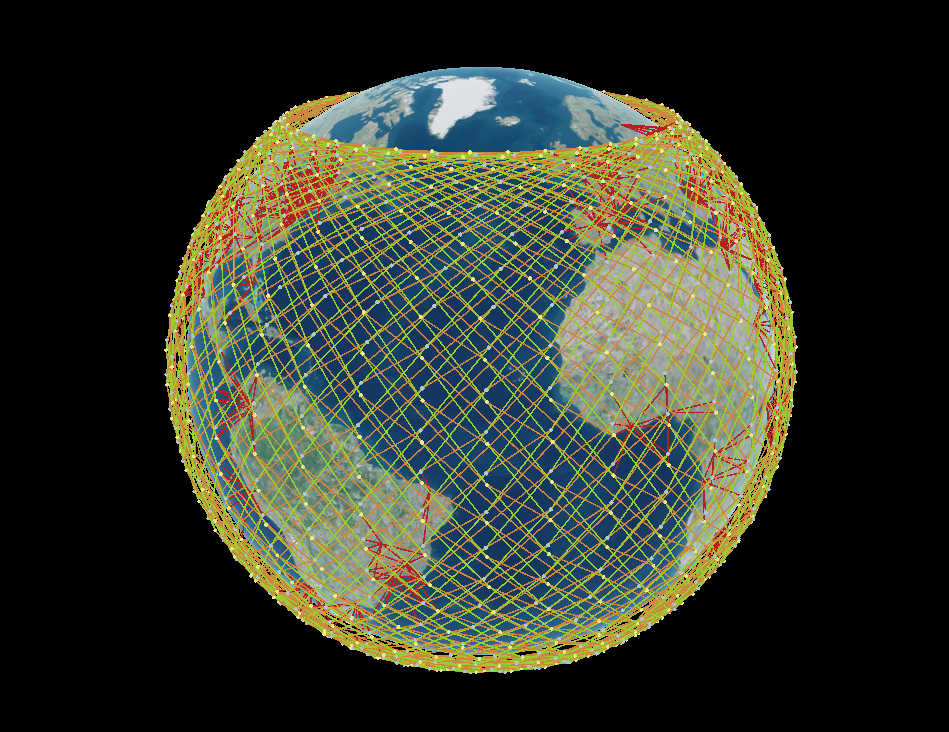

# sat_com_adapter Package

This package is used to implement features that transform topology into configuration files. In a layered architecture it is the presentation layer.

The implemented output are:
- NetworkX
  - Python graph
  - json export

Todo:
- Implement [Gonetem](https://github.com/mroy31/gonetem) support.
- Configure [Hypatia](https://github.com/snkas/hypatia) support.
- Configure output file in the YAML configuration file .

## Example
### NetworkX Adapter
#### NetworkX Builder
NetworkX builder is the object used to create networkX graph, it will be used in the NetworkXAdapter. NetworkX Builder
will define what we want to export in the adapter. 
The adapter is the layer that export the Builder into a file.

##### Available options
- export_positions: boolean, if True, will export the nodes positions
- export_link_length: boolean, if True, will export link length (distance in meters)
- enable_export_flows_data: boolean, if True, will export data about the amount of flows crossing links in both directions
##### Code
```py
from sat_com_adapter.networkx_builder.networkx_builder import NetworkxBuilder
from sat_com_adapter.adapters import NetworkXAdapter
from sat_com_application.simulation_manager import SimulationManager
from sat_com_model.models import Simulation

my_example_simulation = Simulation()
example_simulation_manager = SimulationManager(my_example_simulation)

network_x_builder = NetworkxBuilder(example_simulation_manager, 
                                    export_positions=True, 
                                    export_link_length= True, 
                                    enable_export_flows_data= True
                                    )

my_networkx_graph = network_x_builder.graph

networkx_adapter = NetworkXAdapter(example_simulation_manager)
networkx_adapter.adapt("my_out_put_directory") # Export the graph (not mandatory)
```

#### Graph Structure
```py
graph_as_dict_structure = {
    "directed": False,
    "multigraph": False,
    "graph": {},
    "nodes": [
        {
            "type": "Satellite",
            "id": 0,
            "position": { # if export_positions =  True
              "longitude": 50,
              "latitude": 65,
              "altitude": 500, # In kilometer ?
            }
        },
        {
            "type": "Satellite",
            "id": 1,
            "position": { # if export_positions =  True
              "longitude": 50,
              "latitude": 65,
              "altitude": 500, # In kilometer ?
            },

        }
    ],
    "links": [
        {
            "type": "InterSatelliteLink",
            "direction": "ORBITAL",
            "source": 1,
            "target": 2,
            "used_capacity_between_previous_and_last_hop": { # if enable_export_flows_data is True
              1: 150, # previous hop is 1 (link "source"), next hop is 2
              2: 200  # previous hop is 2 (link "destination"), next hop is 1
            },
            "distance": 500000, # In meters
        },
        {
            "type": "InterSatelliteLink",
            "direction": "ADJACENT",
            "source": 1,
            "target": 24,
            "used_capacity_between_previous_and_last_hop": { # if enable_export_flows_data is True
              1: 15, # previous hop is 1 (link "source"), next hop is 2
              24: 142  # previous hop is 24 (link "destination"), next hop is 1
            },
            "distance": 500000, # In meters          
        }
    ]
}

```
#### With file export
```python
from sat_com_adapter.adapters import NetworkXAdapter
from sat_com_application.simulation_manager import SimulationManager
from sat_com_model.models import Simulation

my_example_simulation = Simulation()
example_simulation_manager = SimulationManager(my_example_simulation)

network_x_adapter = NetworkXAdapter(example_simulation_manager)

network_x_adapter.adapt("my_folder")
```
Result:
```json
{
  "directed": false,
  "multigraph": false,
  "graph": {},
  "nodes": [
    {
      "type": "Satellite",
      "id": 0
    },
    {
      "type": "Satellite",
      "id": 1
    }
  ],
  "links": [
    {
      "type": "InterSatelliteLink",
      "direction": "ORBITAL",
      "source": 1,
      "target": 2
    },
    {
      "type": "InterSatelliteLink",
      "direction": "ADJACENT",
      "source": 1,
      "target": 24
    }
  ]
}
```
We have to improve the adapt() method, because now it returns a default networkx graph without any addition data.

### Without file export

```python
from sat_com_adapter.adapters import NetworkXAdapter
from sat_com_application.simulation_manager import SimulationManager
from sat_com_model.models import Simulation

my_example_simulation = Simulation()
example_simulation_manager = SimulationManager(my_example_simulation)

network_x_adapter = NetworkXAdapter(example_simulation_manager)

my_nx_graph = network_x_adapter.create_full_networkx_graph(export_link_length=True, export_object_position=True)
```
You can still use json_graph api from networkX to export a file later.

### Cesium Adapter
This adapter allow you to export your simulation as a Html File with Cesium. This adapter works with CesiumRenderer API.

#### With the default method

```python
from sat_com_application.simulation_manager import SimulationManager
from sat_com_model.models import Simulation
from sat_com_adapter.adapters import CesiumAdapter

my_example_simulation = Simulation()

simulation_manager = SimulationManager(my_example_simulation)

cesium_adapter = CesiumAdapter(simulation_manager)

renderer = cesium_adapter.create_cesium_renderer("MY_SUPER_SECRET_CESIUM_TOKEN_OR_NOTHING")

renderer.add_satellites()

cesium_adapter.adapt("my_folder")
```

#### With the pre-build

```python
from sat_com_application.simulation_manager import SimulationManager
from sat_com_model.models import Simulation
from sat_com_adapter.adapters import CesiumAdapter

my_example_simulation = Simulation()

simulation_manager = SimulationManager(my_example_simulation)

cesium_adapter = CesiumAdapter(simulation_manager)

renderer = cesium_adapter.build_renderer_simulation_with_links("MY_SUPER_SECRET_CESIUM_TOKEN_OR_NOTHING")

cesium_adapter.adapt("my_out_put_folder")
```
### With custom render

Customize your renderer with the CesiumRenderer API, then set it in the adapter before calling adapt() method.
You can access to CesiumRenderer docs here: [CesiumRenderer API](cesium_renderer/README.md).

```python
from sat_com_application.simulation_manager import SimulationManager
from sat_com_model.models import Simulation
from sat_com_adapter.cesium_renderer.renderers import CesiumRenderer
from sat_com_adapter.adapters import CesiumAdapter
from sat_com_adapter.cesium_renderer.models import CesiumProperty

my_example_simulation = Simulation()

simulation_manager = SimulationManager(simulation=my_example_simulation)

cesium_adapter = CesiumAdapter(
  simulation_manager=simulation_manager
)

cesium_property = CesiumProperty()

cesium_property.cesium_token = "MY_SUPER_SECRET_CESIUM_TOKEN_OR_NOTHING"

custom_renderer = CesiumRenderer(
  simulation_manager=simulation_manager, 
  cesium_renderer_property=cesium_property
)

custom_renderer.add_satellites()

custom_renderer.add_ground_stations()

cesium_adapter.set_custom_renderer(cesium_renderer=custom_renderer)

cesium_adapter.adapt("my_file_name.html")

```

