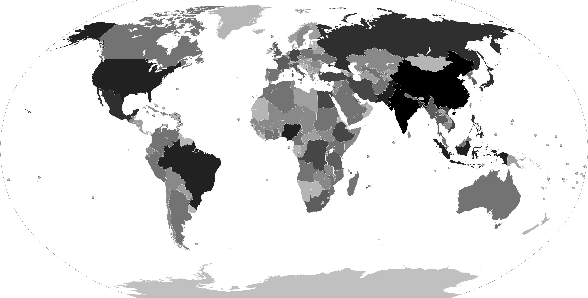
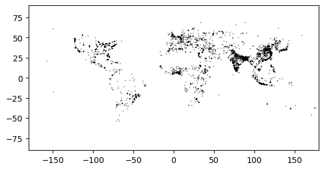
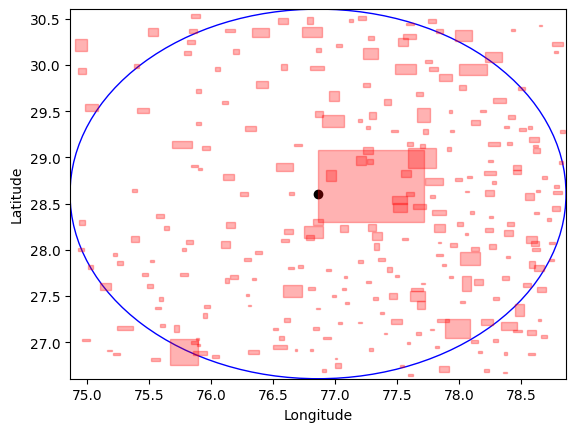
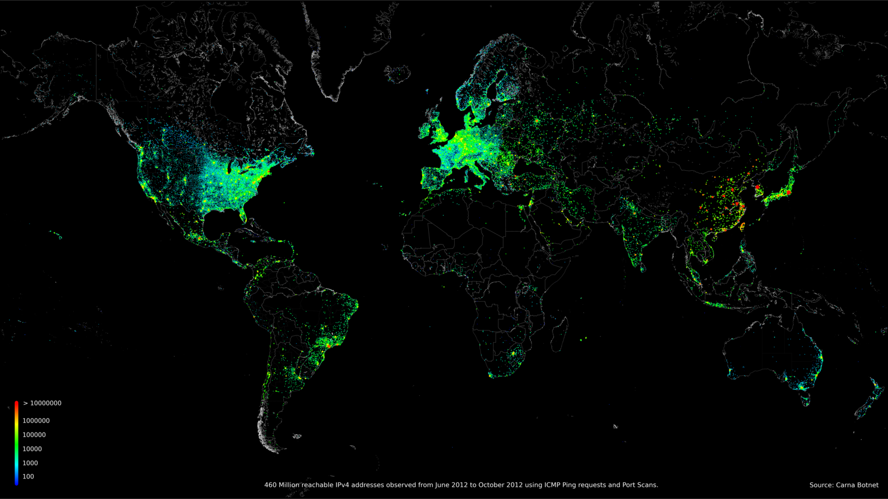
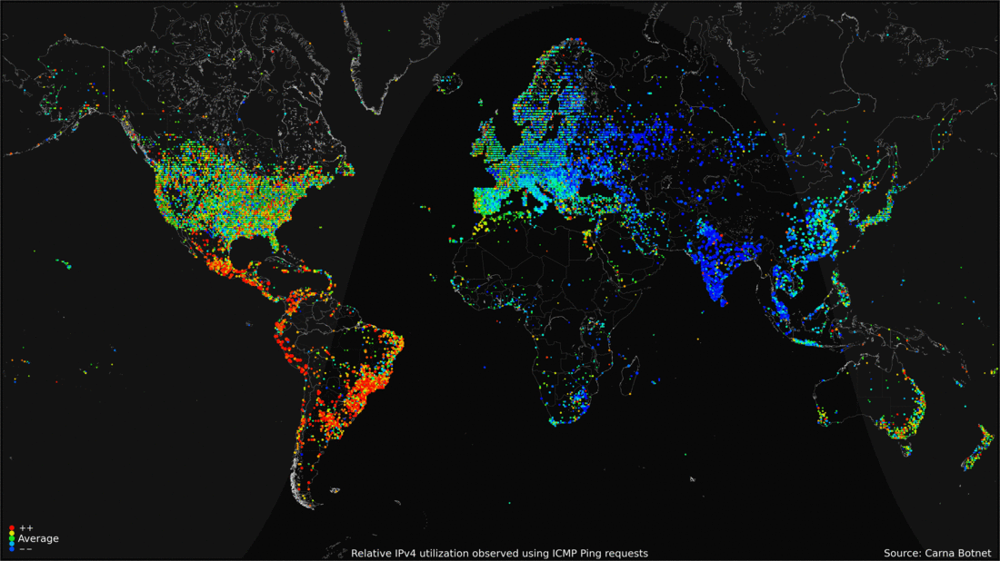
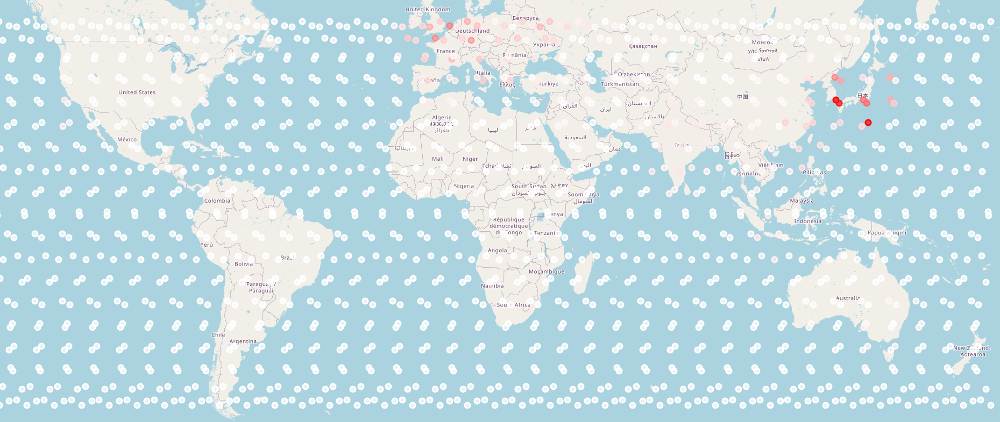

# sat_com_traffic Package
⚠️ This is an unstable package. 
## Description 📃 
This package is designed to generate traffic. This package is unstable and will often
be updated.
This package expose a traffic model that we calculate the potential amount of user on ground below each
satellite. Based on this value, it will calculate sources and destination.
This package implement earth_internet_user_generator package.

### **GeographicalBasedTrafficModel**, a model that generate population based traffic 🌍
#### Introduction
This model try to provide an accurate amount of constellation user across the earth. As we don't have 
a lot of data, the generated figures are still fake, but they reflect the internet usage behavior in the world.

#### The GHS Urban Centre Database 2015 🇪🇺
To have an accurate distribution of the earth population we use the "GHS Urban Centre Database 2015", created by
Based on the description publication, the objective of this database is the following:

>This publication is a Scientific Information Systems and Databases report by the Joint Research Centre (JRC),
the European Commission’s science and knowledge service. It aims to provide evidence-based scientific support
to the European policymaking process. The scientific output expressed does not imply a policy position of the
European Commission. Neither the European Commission nor any person acting on behalf of the Commission is
responsible for the use that might be made of this publication.

[Bibliography](#bibliography)

[Visit the publication's website here](https://op.europa.eu/en/publication-detail/-/publication/aec4581b-29c5-11e9-8d04-01aa75ed71a1/language-en)

This Urban Centre database will help you to locate users. Countries like Russia or China are populated but very large.
China is an urbanised country, and the cities are more developed than countryside. A realistic distribution of 
the chinese population (1.4b inhabitant)' will help to simulation congestion event. The communication from the Goby desert
will not be the same as in the Surrounding of beijing or Guangzhou.

The following image represent the world population distribution per country.

.


The following image display the distribution of urban center around the world.

.

The Urban Centre dataset provides development indicators (DEV_CMI). We use this development indicator to balance the usage of the constellation
between countries. Indeed, Constellation subscription are expensive and still not accessible everywhere.

The following image show the New Delhi's and surrounding urban centers.

.


##### Unused interesting data
The dataset provides unused data that maybe we should implement to have a better system:
- Income class (INCM_CMI)
- Accessibility & Remoteness (TT2C), if we want to model a realistic individual usage of the constellation.
The goal of constellation is to provide internet access to remoteness areas. We can implement a model that use this information


### Internet Census 2012: Carna Botnet
The Internet Census 2012 is a huge attack on about 400k embedded devices that were open the Internet. The hacker
created a distributed port scanner to scan all IPV4 address and shared all the gathered data to the 
public domain. The following images were generated by the Hacker.



The data are available [here](https://internetcensus2012.github.io/InternetCensus2012/download.html).

Based on this data, the user created an animated image that show the internet usage across the day.
We use this image to approximately ponderer our amount of user. Of course the usage may different from countries, and moreover cultures.
To simplify the model, I took the european habits.



Note: an interesting study would be to download those data and make a real mathematical model,
which would be based on the values. The current model use only a visual interpretation.

### Computation of the model
- Get the position of a satellite
- Get the urbans centers U in range of the satellite
- For each U get the population amount
- Multiply the population by the development modifier (0<modifier<1), that give the population/dev
- Multiply the population/dev by the hourly modifier gives you the first limit for the amount of user
- Multiply the population/dev by the hourly modifier - 1  gives you the second limit of the amount of user
- max_limit = max(first_limit, second_limit)
- min_limit = min(first_limit, second_limit)
- amount of user = random(min_limit, max_limit)
- We divide the amount of user by the number of satellite in the same range as the current satellite (more you have satellites, less you have User per satellite)
- Draw randomly X satellites weighted with their amount of user
- Draw randomly Y satellites weighted with their amount of user
- for each X,Y , you have a pair of  source destination (Xi as source, Yi as destination)

### Result example
The following table represent top 20 source destinations generated by the traffic model based on 
10k draws.  We can see that some cities are more represented than the other.
- There are more satellites in the north hemisphere
- The simulation time is 1pm (13:00) UTC, that explain:
  - Users are mostly in east Asia (Japan) where the local time is 10pm (22:00)
  - Users are in Europe too, where Paris time is 1pm (13:00)
  - There are some user in the American East coast (not in the table), where the local time is 9am (09:00)

The used modifiers for this simulation are the following:
Level of development areas are the following: (Developed: 1, In development: 2, Least developed: 3)
```py
development_modifier = {1: 0.01, 2: 0.05, 3: 0.80}
```
1000 people in a developed area will result in 800 potential users.

The daily multiplier correspond to 4 hours tranches (24/6 = 4), ex: first tranche is from 24am to 4am.
```py
daily_multiplier = {
    1: 0.10,
    2: 0.05,
    3: 0.50,
    4: 0.75,
    5: 0.95,
    6: 0.30,
}
```
if the local time of the 800 previous potential user is 1am, the potential user value will be:
0.10 * 800 = 80.
Then we calculate the same amount for the previous hour:
0.30 * 800 = 240.
The amount of user will be a random number between 80 and 240.

Todo: To improve the model we should maybe make more hours tranches.

Note that those previous parameters should be modified, those are the default ones. In the future, we will provide a way
to make the parameterization easier.


| urban center source    | urban center destination   |   amount of flows |
|:-----------------------|:---------------------------|------------------:|
| Osaka [Kyoto]          | Osaka [Kyoto]              |               380 |
| Osaka [Kyoto]          | Dublin                     |               130 |
| Dublin                 | Osaka [Kyoto]              |               125 |
| Osaka [Kyoto]          | Paris                      |                99 |
| Paris                  | Osaka [Kyoto]              |                91 |
| Osaka [Kyoto]          | London                     |                85 |
| London                 | Osaka [Kyoto]              |                81 |
| Guangzhou              | Osaka [Kyoto]              |                64 |
| Osaka [Kyoto]          | Guangzhou                  |                63 |
| Osaka [Kyoto]          | Birmingham                 |                62 |
| Birmingham             | Osaka [Kyoto]              |                61 |
| Osaka [Kyoto]          | Rotterdam [The Hague]      |                51 |
| Rotterdam [The Hague]  | Osaka [Kyoto]              |                50 |
| Dublin                 | Dublin                     |                49 |
| Osaka [Kyoto]          | Nanchang                   |                47 |
| Paris                  | Dublin                     |                41 |
| Nanchang               | Osaka [Kyoto]              |                41 |
| Dublin                 | Paris                      |                39 |
| Osaka [Kyoto]          | Lisbon                     |                39 |
| Multan                 | Osaka [Kyoto]              |                37 |

Note: these are cities example where you have flows, but that doesn't mean all flows
leaves from Osaka or Paris, other urban  center are taken in account.
(Osaka would contain Tokyo for example, and Paris the whole north/center of France)

The following image illustrate the previous table:



Each dot represent a Satellite. More the satellite is red more it has potential users (it shows the weights, not the flows in contrary to the previous table)

### How to use  🎓
### Calculate amount of User for a satellite
```python
from sat_com_builder.configuration_manager import EmptyConfigurationManager
from sat_com_traffic.traffic_models import GeographicalBasedTrafficModel

empty_configuration = EmptyConfigurationManager()
simulation_manager = empty_configuration.load_simulation()

traffic_model = GeographicalBasedTrafficModel()
traffic_model.center_urban_minimum_population = 1000000 # We will tak only urban center with population > 1000000
traffic_model.simulation_manager = simulation_manager # Set the simulation_manager. Todo add simulation manager in the constructor

traffic_model.calculate_amount_of_potential_user_per_satellite(satellite_range_in_km=500) # Calculate amount of potential user per satellite. Satellite cover a 500 km zone
```
#### Other useful methods
```python
from sat_com_builder.configuration_manager import EmptyConfigurationManager
from sat_com_traffic.traffic_models import GeographicalBasedTrafficModel

empty_configuration = EmptyConfigurationManager()
simulation_manager = empty_configuration.load_simulation()

traffic_model = GeographicalBasedTrafficModel()
traffic_model.center_urban_minimum_population = 1000000 # We will tak only urban center with population > 1000000
traffic_model.simulation_manager = simulation_manager # Set the simulation_manager. 

traffic_model.calculate_amount_of_potential_user_per_satellite(satellite_range_in_km=500) # Calculate amount of potential user per satellite. Satellite cover a 500 km zone

traffic_model.get_k_random_satellite_based_on_users_probability(k=10) # Get 10 random satellite with population as weight

traffic_model.get_set_of_random_k_pairs_of_satellite(k=10) # Get 10 pair between randomly chosen satellites with population as weight
```
### Identified limits of the model ⚡
- As explained in [the previous section](#the-ghs-urban-centre-database-2015), there are some values that we should take in account, plus currently the model doesn't reflect the use of in remote users
- The users can be in roaming on land or on the sea
- The military usage is totally absent. If we want to work on that we should maybe add warzone date
- Difficulties to know the real amount of user. The relevant value is the ratio flows.
- Most of the users are located in wll developed and

### Todo
- Make the parameters change easier.

### Bibliography 📎
European Commission, Joint Research Centre, Corbane, C., Freire, S., Maffenini, M. et al., Description of the GHS Urban Centre Database 2015 – Public release 2019 – Version 1.0, Publications Office, 2019, https://data.europa.eu/doi/10.2760/037310
Internet Census 2012, https://internetcensus2012.github.io/InternetCensus2012/paper.html
